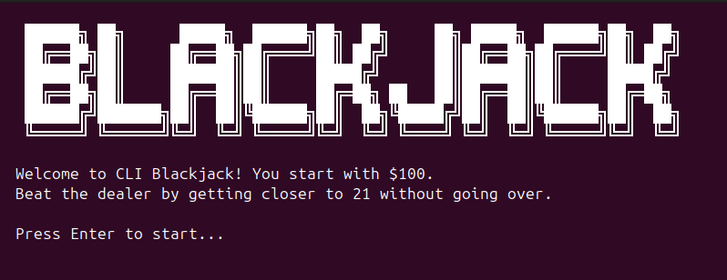

# 🎮 Juegos de Terminal

> Aquí tenéis un regalito para el tiempo muerto.
>
> Una colección de juegos clásicos para la terminal. Sin instalaciones complicadas, sin dependencias raras. Solo Python y ganas de jugar.



---

## 🚀 Cómo empezar (en 3 pasos)

### 1. Descarga el repo

Con Git:
```bash
git clone https://github.com/tu-usuario/Juegos_de_termial.git
cd Juegos_de_termial
```

O descarga el ZIP desde el botón verde **<> Code** → **Download ZIP** y descomprímelo.

### 2. Asegúrate de tener Python 3

```bash
python3 --version
```

Si no lo tienes, instálalo: [python.org/downloads](https://python.org/downloads)

### 3. Juega

Cada juego está en su propia carpeta dentro de `juegos/`. Para empezar a jugar:

```bash
# Blackjack 🃏
python3 juegos/blackjack/blackjack.py
```

Y listo. Sin instalar nada más.

---

## 📁 Juegos disponibles

| Juego | Carpeta | Estado |
|-------|---------|--------|
| Blackjack | `juegos/blackjack/` | ✅ Listo |

> Más juegos en camino... 🚧

---

## 🛠️ Requisitos

- Python 3.7 o superior
- Terminal con soporte para Unicode (para los emojis y símbolos de cartas)

---

## 🤝 ¿Quieres sumar un juego?

1. Crea una carpeta nueva dentro de `juegos/nombre-del-juego/`
2. Mete tu script `.py` ahí dentro
3. Abre un PR y lo mergeamos

---

Hecho con 🖤 para matar el aburrimiento.
